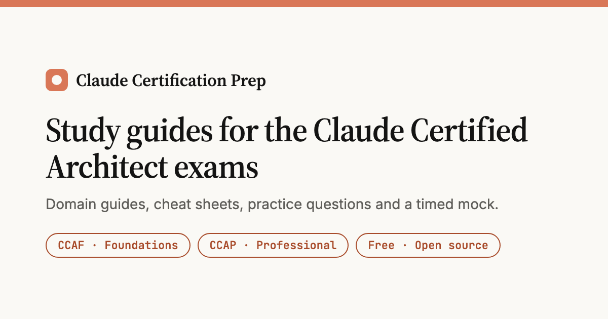

[](https://mukesh-simform.github.io/claude-certified-architect-guide/)

# Claude Certification Prep

Independent, free study guides for the **Claude Certified Architect** exams. Static site, no build step, deployed with GitHub Pages.

**Live site:** https://mukesh-simform.github.io/claude-certified-architect-guide/

> Community-written and not affiliated with, endorsed by or reviewed by Anthropic. All practice questions are original study material written with AI assistance: they are not real exam questions and do not predict exam content. Product details change, so when this guide and the current Anthropic docs disagree, the docs win.

**Last reviewed:** October 2026.

## What is inside

| Guide | Exam | What you get |
|---|---|---|
| [CCAF guide](https://mukesh-simform.github.io/claude-certified-architect-guide/ccaf/) | Foundations | 5 domains, cheat sheets, code examples, 12 sample questions, 4 hands-on exercises |
| [Practice hub](https://mukesh-simform.github.io/claude-certified-architect-guide/practice/) | Both | Links to the CCAF practice bank and the CCAP timed mock |
| [CCAF practice](https://mukesh-simform.github.io/claude-certified-architect-guide/ccaf/practice.html) | Foundations | 62 scenario questions across all 6 scenarios, domain filter, saved progress |
| [Courses](https://mukesh-simform.github.io/claude-certified-architect-guide/courses/) | Both | CCAF and CCAP prep courses, optional courses and official links |
| [CCAP playbook](https://mukesh-simform.github.io/claude-certified-architect-guide/ccap/) | Professional | 7 domains, 38-objective map, distractor patterns, cheat sheet, 49 exact facts, 129 questions, 63-question timed mock with resume and answer review |

## Exams at a glance

| | CCAF (Foundations) | CCAP (Professional) |
|---|---|---|
| Domains | 5: Agentic Architecture 27%, Tools & MCP 18%, Claude Code 20%, Prompting 20%, Context 15% | 7: Solution Design 17%, Models & Prompting 13%, Integration 19%, Evaluation 16%, Governance 14%, Stakeholders 14%, Developer Productivity 7% |
| Format | Scenario-based multiple choice | Multiple choice and multiple response, 63 items, 120 minutes |
| Pass mark | 720 / 1,000 | 720 / 1,000 |

Exam details are as of October 2026. Check the official exam pages and Anthropic Academy for current fees, eligibility and policies before booking. Practice exams are available in your Anthropic Academy account.

## Repository layout

Each section is self-contained: its page, styles, scripts and data live in the same folder.

```
index.html                  landing page
404.html                    not-found page; also forwards the old questions.html and courses.html URLs
ccaf/                       Foundations: index.html (guide), practice.html, ccaf.css/js, practice.css/js
ccap/                       Professional: index.html (playbook, practice sets, timed mock), ccap.css/js, questions.js
courses/                    Courses for both exams: index.html, courses.css
practice/                   Practice hub linking both exams: index.html
assets/css/theme.css        shared design tokens and site chrome (light and dark)
assets/js/                  theme.js (toggle, review date), legacy-redirect.js (old-URL forwarding)
assets/img/                 social card, touch icon
scripts/sync-head-footer.py  applies shared <head> sharing tags and the footer to every page
scripts/check-questions.js  question-bank and anchor checks (run in CI)
.github/                    CI (HTML validation, link check, question checks), issue and PR templates
```

Light and dark themes share one set of tokens in `assets/css/theme.css`. Progress (answers, ticks, an in-progress mock) is stored in the visitor's browser only. The "last reviewed" date shown on every page comes from `assets/js/theme.js`.

## Run locally

```bash
python3 -m http.server 8000
# open http://localhost:8000/

node scripts/check-questions.js          # question banks and anchors
npx html-validate "*.html" "*/*.html"
```

## Deploying

GitHub Pages, **Deploy from a branch**, `master` / root. `.nojekyll` turns off Jekyll processing. If you fork or rename the repo, update the `/claude-certified-architect-guide/` prefix in `404.html` and the base URL in `scripts/sync-head-footer.py`, `robots.txt` and `sitemap.xml`, then run `python3 scripts/sync-head-footer.py`.

## Contributing

See [CONTRIBUTING.md](CONTRIBUTING.md). Fixes and corrections backed by a link to the current Anthropic docs are especially welcome.

## License

MIT, see [LICENSE](LICENSE). Claude and Anthropic are trademarks of Anthropic, PBC.
